# In silico design of a multi-epitope vaccine candidate against _Klebsiella pneumoniae_ targeting the outer membrane lipoprotein [Pal]

**Author:** [Adene] · **Status:** Computational study; no experimental validation

---
### Overview

This repository documents a reverse-vaccinology workflow for designing a multi-epitope vaccine (MEV) against _Klebsiella pneumoniae_. The target is Pal; a peptidoglycan-associated outer membrane lipoprotein. Predictions come from free web servers, and short Python scripts handle the filtering. Raw server outputs are stored unedited so every result can be checked.

Two constructs were designed: **MEV-1**, with the cholera toxin B subunit as adjuvant, and **MEV-2**, with human β-defensin 2. Both were evaluated for physicochemical properties, structural quality, TLR4 docking, flexibility, codon-optimised expression in _E. coli_, in silico cloning and simulated immune response.

---
### Workflow
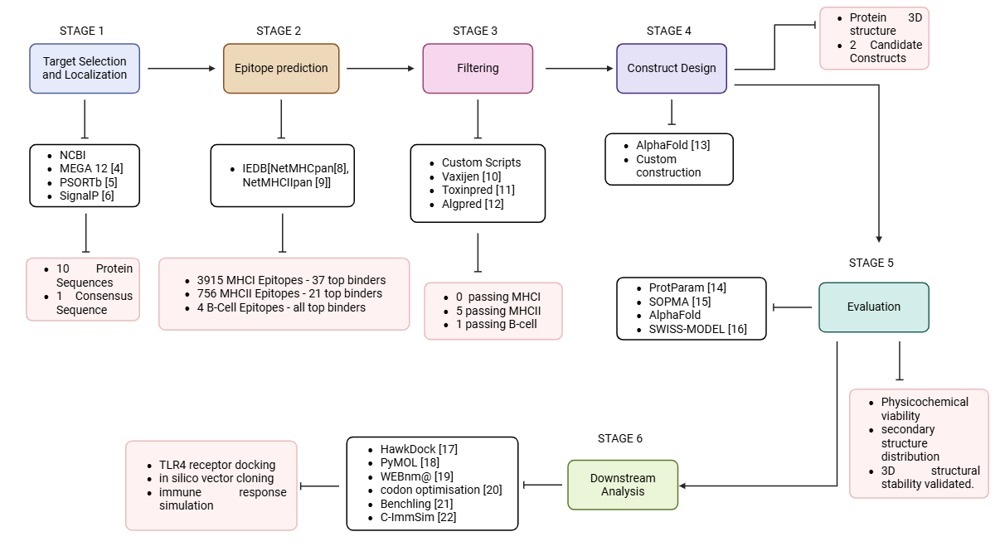

---
### Results
**1. Target and localization:** The Peptidoglycan-Associated Lipoprotein (Pal) was selected as the primary antigenic target from the outer membrane virulence factors of _Klebsiella pneumoniae_, **10** sequences ranging from 170 to 185 amino acids in length were obtained from NCBI, and a consensus sequence was derived using the MUSCLE algorithm in MEGA 12. Subcellular localization and signal peptide analyses via PSORTb and SignalP support its outer membrane placement and identified a Sec/SPII signal peptide cleavage site between positions 21 and 22. Consequently, the signal peptide was computationally truncated to yield a mature 153-amino acid sequence.

NCBI search string [ _Klebsiella pneumoniae_ Pal ATCC 13883]

Sequence Alignment on MEGA 12

PSORTb Localisation scores and SignalP output plot

| Cytoplasmic          | 0.00  |
| -------------------- | ----- |
| Cytoplasmic Membrane | 0.00  |
| Periplasmic          | 0.00  |
| Outer Membrane       | 10.00 |
| Extracellular        | 0.00  |

**2. Epitopes & Filtering:** Linear B-cell, MHC-I, and MHC-II epitopes were predicted from the consesus Pal sequence utilizing the IEDB servers, employing the BepiPred v3.0, NetMHCpan EL 4.1, and NetMHCIIpan EL 4.1 algorithms across 27 human alleles. To ensure maximum immunogenic efficacy, the initial datasets comprising **3,915** MHC-I and **756** MHC-II predicted epitopes were narrowed down to 37 and 21 top binders respectively, with **4** predicted B-cell epitopes, and filtered via custom Python scripts, VaxiJen v2.1 (threshold 0.3), ToxinPred 3.0, and AlgPred 2.0. This screening yielded zero viable MHC-I candidates, but successfully isolated five MHC-II epitopes and one B-cell epitope that strictly met all required thresholds for antigenicity, non-toxicity, and non-allergenicity.

B-Cell passing Epitope

| Peptide                                    | Antigenicity      | Toxicity  | Allergenicity         |
| ------------------------------------------ | ----------------- | --------- | --------------------- |
| NKNASNDQSGEGMLGAGTGMDANGNGGNMSSEEQARLQMQQL | Probable antigen. | Non-Toxin | Probable Non-Allergen |

MHCII Passing Epitopes

| Peptide         | Antigenicity | Toxicity  | Allergenicity | Immunogenicity |
| --------------- | ------------ | --------- | ------------- | -------------- |
| DKYDIRSDFAAMLDA | antigen      | Non-Toxin | Non-Allergen  | Immunogen      |
| LGERRANAVKMYLQG | antigen      | Non-Toxin | Non-Allergen  | Immunogen      |
| NGNGGNMSSEEQARL | antigen      | Non-Toxin | Non-Allergen  | Immunogen      |
| AMLDAHANFLRSNPS | antigen      | Non-Toxin | Non-Allergen  | Immunogen      |
| VYFDLDKYDIRSDFA | antigen      | Non-Toxin | Non-Allergen  | Immunogen      |

**3. Construct Design:** A 3-dimensional prediction of consesus Pal protein was obtained via AlphaFold and Epitope surface exposure was validated via Pymol. Two multi-epitope vaccine candidates were manually constructed by assembling the validated epitopes with GPGPG linkers and conjugating them via EAAAK linkers to either Cholera enterotoxin subunit B (MEV-1) or Human beta-defensin 2 (MEV-2) adjuvants, with the native signal peptides of both adjuvants cleaved. Initial physicochemical assessments via Expasy ProtParam indicated structural instability, prompting the integration of a 109-amino acid _E. coli_ Thioredoxin (Trx) chaperone tag to restore thermodynamic stability, terminating with a 6xHis-tag. Final evaluations confirmed that both complete MEV sequences exhibit optimal structural parameters, classifying them as stable, hydrophilic candidates.
Secondary structure profiles were first established using SOPMA, followed by 3D tertiary structure modeling via AlphaFold and validated through SWISS-MODEL, yielding favored Ramachandran plots (>91%)

Consesus Structure with surface exposed Epitopes coloured
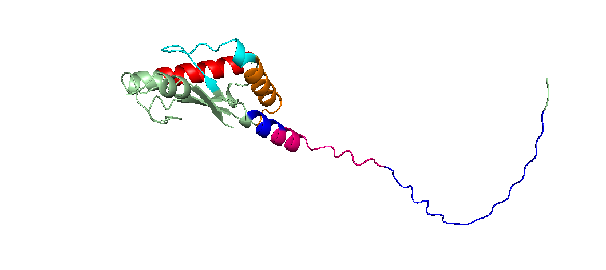
(NOTE: See "results/Structures/Pymol" for individual surface exposure)

MEV Design Chain-- [Adjuvant] - EAAAK - [MHC-II] - GPGPG - [B-cell] – HHHHHH

Expasy data for both constructs

| Physiochemical Properties               | MEV-1                  | MEV-2                  |
| --------------------------------------- | ---------------------- | ---------------------- |
| Total Number of Amino Acids             | 320                    | 258                    |
| Molecular Weight (MW)                   | 34902.51 Da / 34.9 kDa | 27591.39 Da / 27.6 kDa |
| Theoretical pI (Isoelectric Point)      | 5.88                   | 6.49                   |
| Instability Index (II)                  | 32.29                  | 31.75                  |
| Aliphatic Index                         | 79.72                  | 74.61                  |
| GRAVY (Grand Average of Hydropathicity) | -0.386                 | -0.367                 |

SOMPA Secondary Structure Data MEV-1
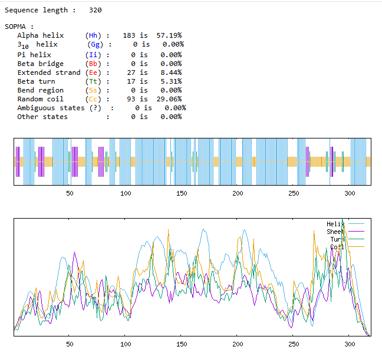
SOMPA Secondary Structure Data MEV-2
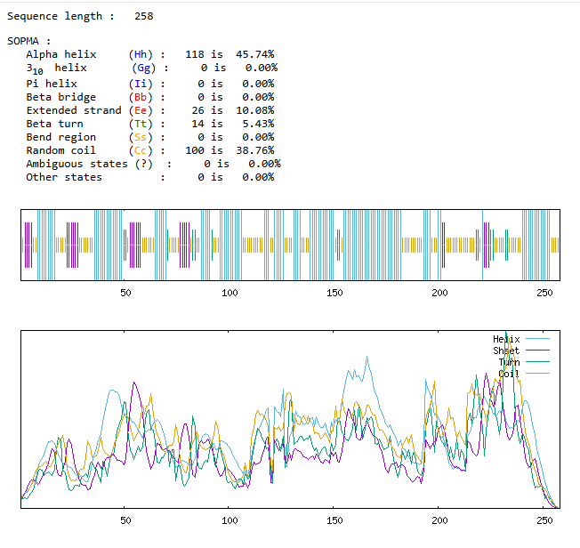
AlphaFold Tertiary structure prediction for MEV-1
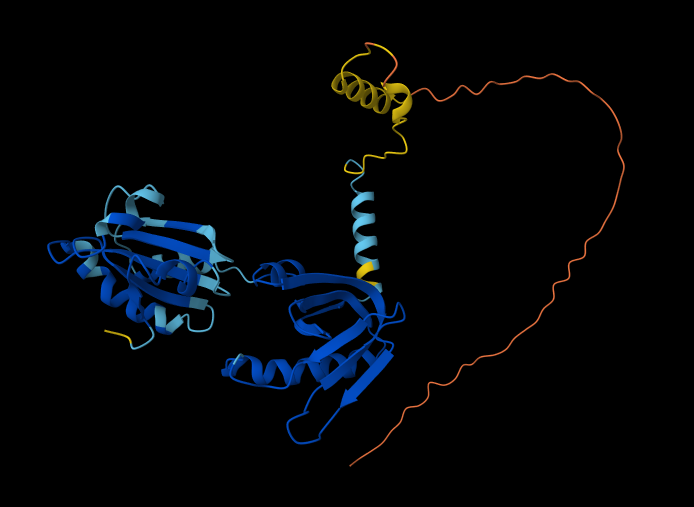

AlphaFold Tertiary structure prediction for MEV-2
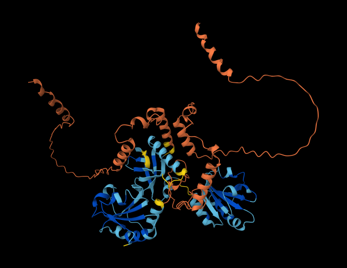

SWISS-MODEL validation and energy requirements.

| Parameter               | MEV-1       | MEV-2       |
| ----------------------- | ----------- | ----------- |
| Ramachandran Favoured   | 92.45%      | 91.02%      |
| MolProbity Score        | 1.95        | 2.00        |
| Clash Score             | 4.95        | 3.93        |
| QMEANDisCo Global Score | 0.58 ± 0.05 | 0.53 ± 0.05 |
| QMEAN Z-Score           | -1.96       | -1.20       |

MEV-1 Ramachandran plot and quality comparison graph
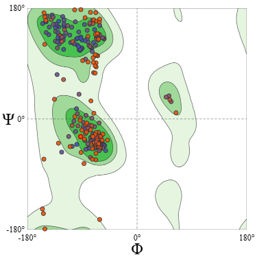
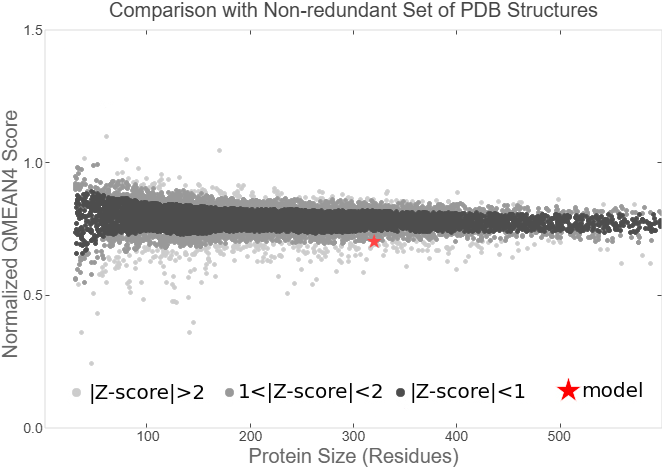
MEV-2 Ramachandran plot and quality comparison graph
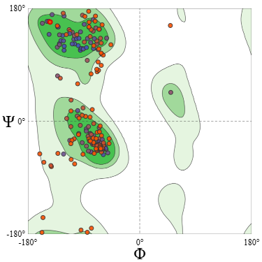
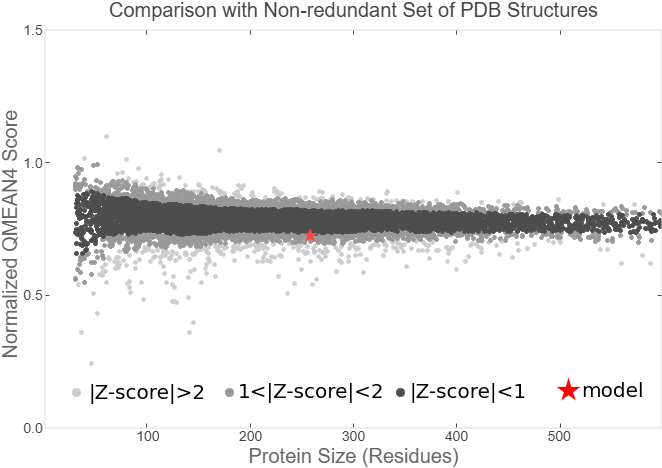

**4. Evaluation:** To evaluate immune receptor interaction, molecular docking against a processed human TLR-4 monomer (chain A) was executed on the HawkDock server. Both constructs demonstrated suitable binding affinities, with MEV-1 and MEV-2 producing strong binding free energies of -24.05 kcal/mol and -51.36 kcal/mol, and docking scores of -5323.90 and -3867.47 respectively, which were subsequently mapped and visualized using PyMOL.

Consolidated interaction table

| Construct | Receptor          | Docking Score | TLR4 (Chain A) Interface Residues                                                                                                                                                     | MEV Interface Residues                                                                                                 |
| --------- | ----------------- | ------------- | ------------------------------------------------------------------------------------------------------------------------------------------------------------------------------------- | ---------------------------------------------------------------------------------------------------------------------- |
| MEV-1     | TLR4, (PDB: 4G8A) | -5323.90      | Lys21 Phe28 Ser45 Tyr46 Phe49 Pro52 Glu68 His203 His230 Arg231 Glu260 Glu261 Tyr377 Glu399 His400 Ile424 Glu448                                                                       | Ala88 Ala89 Thr90 Glu102 Ala106 Asn107 Gln112 Pro249 Gly250 Pro251 Gly252 Glu255 Gln266 Pro269 Gly270                  |
| MEV-2     | TLR4, (PDB: 4G8A) | -3867.47      | Arg238 Glu244 Tyr266 Leu267 Asp268 Tyr269 Tyr270 Thr293 Lys315 Lys336 Gly337 Asn339 Asn383 Gly384 Asn407 His432 Arg434 Gly454 Asn455 Ser456 Phe457 Glu459 Asn460 Gln481 Glu483 Gln484 | Met239 Ser240 Ser241 Glu242 Glu243 Gln244 Ala245 Leu247 Gln248 Gln250 Gln251 Leu252 His253 His254 His255 His256 His257 |

MEV-1[TLR4] complex
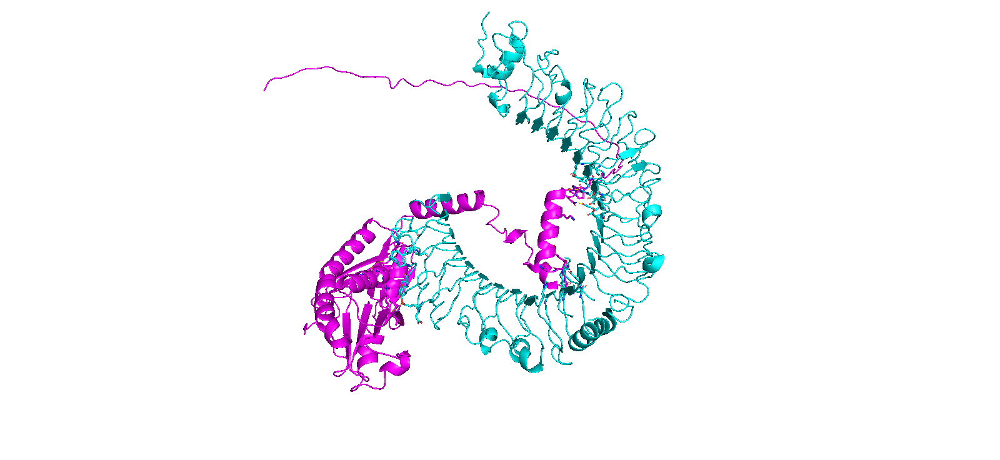
MEV-2[TLR4] complex
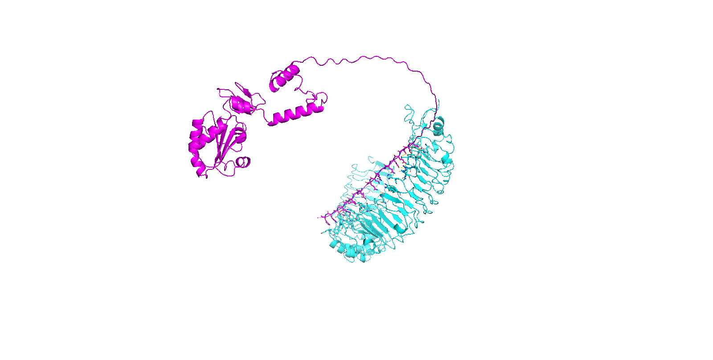
MEV structure in purple and TLR4 fragment in cyan

**5. Downstream analysis:** Normal mode analysis to determine the structural flexibility of the constructs was run, and both sequences were subsequently codon-optimized for _E. coli_ expression, successfully elevating their GC content into the viable optimal range without altering the amino acid sequence. The optimized genes were _in silico_ cloned into the pET-28a(+) expression vector via NdeI and XhoI restriction sites using Benchling, while extended 1,000-step multi-dose C-ImmSim simulations predicted the induction of long-lasting cellular and humoral immune memory.

The correlation, deformation, displacement, and eigen plots were recorded for both:
MEV-1
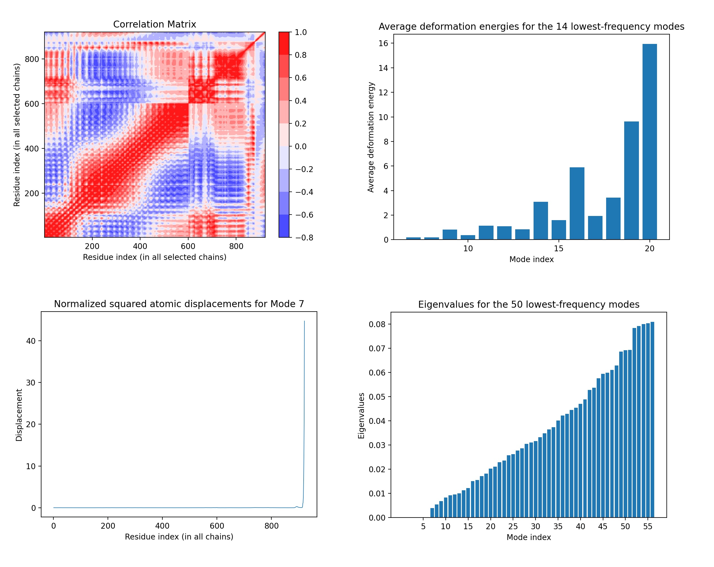

And MEV-2
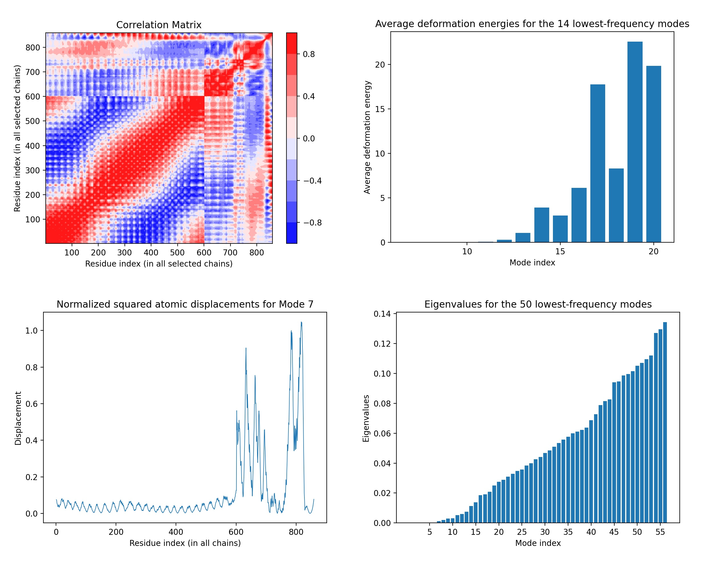
Mode and deformation energies were also noted

| MEV-1 | MODE | DEFORMATION ENERGY |     | MEV-2 | MODE | DEFORMATION ENERGY |
| ----- | ---- | ------------------ | --- | ----- | ---- | ------------------ |
|       | 7    | 0.185              |     |       | 7    | 0.01               |
|       | 8    | 0.198              |     |       | 8    | 0.004              |
|       | 9    | 0.831              |     |       | 9    | 0.024              |
|       | 10   | 0.364              |     |       | 10   | 0.042              |

Codon optimization was carried out for E-coli expression and DNA sequence was obtained without altering the Amino acid sequence. 

|                                  | MEV-1             | MEV-2             |
| -------------------------------- | ----------------- | ----------------- |
| Sequence Length                  | 960 nt (bp)       | 774 nt (bp)       |
| GC Content (Before Optimization) | 31.1%             | 33.3%             |
| GC Content (After Optimization)  | 49.9%             | 52.5%             |
| Codon Modifications              | 186 of 320 codons | 153 of 258 codons |

Cloning was achieved using the pET-28a(+) expression vector utilizing the NdeI and XhoI restriction sites.
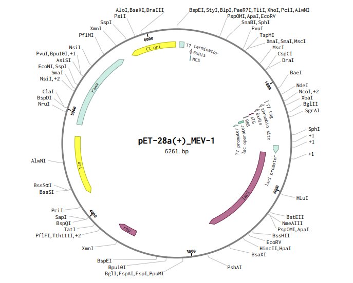
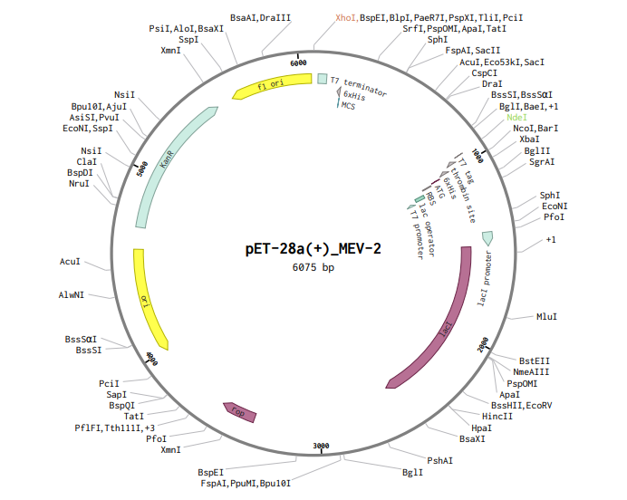

Immune simulation was carried out on C-IMMSIM, 6 plots were obtained describing predicted immune activity following a 1000 step 3 dose interaction across a timeframe: 
For MEV-1
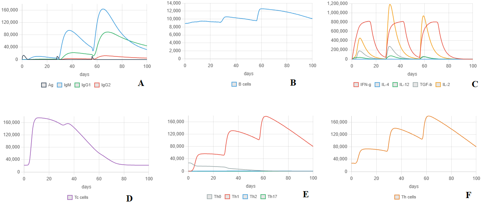

For MEV-2
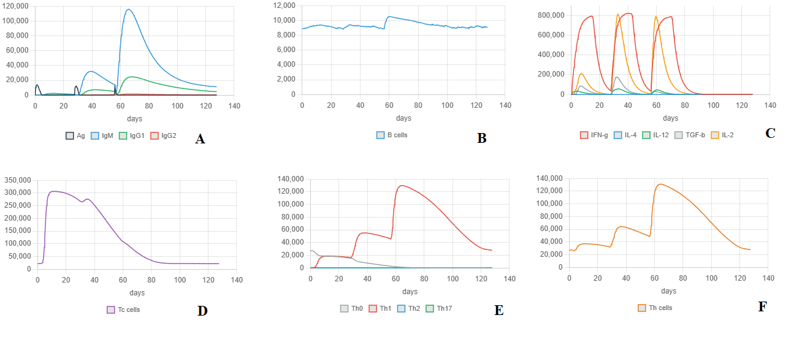

With (A) describing the Antigens and antibodies reaction, (B) relating B-cell response, (C) relating Cytokines, (D) describing cytotoxic T-cell reaction, (E) relating the TH-subset, describing both T-cell population interaction, and (F) describing helper T-cell reaction.

### Limitations
- This methodology is strictly computational; _in vitro_ and _in vivo_ experimental validation is required to confirm actual physical expression, biological safety, and clinical immunogenicity.
    
- The accuracy of epitope prediction and structural modeling is inherently limited by the quality and diversity of the training datasets used by the underlying algorithms.
    
- _In silico_ immune simulations simplify complex biological microenvironments and may not fully capture the variability of a natural human immune response.

### References
Studies reviewed

[1] Abbas, R., Chakkour, M., Dine, H. Z. E., Obaseki, E. F., Obeid, S. T., Jezzini, A., Ghssein, G., & Ezzeddine, Z. (2024). General Overview of Klebsiella pneumonia: Epidemiology and the Role of Siderophores in Its Pathogenicity. Biology, 13(2), 78. https://doi.org/10.3390/biology13020078

[2] Paczosa, M. K., & Mecsas, J. (2016). Klebsiella pneumoniae: Going on the Offense with a Strong Defense. _Microbiology and Molecular Biology Reviews_, _80_(3), 629–661. https://doi.org/10.1128/mmbr.00078-15

[3] Zhu, J., Wang, T., Chen, L., & Du, H. (2021). Virulence Factors in Hypervirulent Klebsiella pneumoniae. _Frontiers in Microbiology_, _12_, 642484. https://doi.org/10.3389/fmicb.2021.642484

[15] LaVallie, E. R., DiBlasio, E. A., Kovacic, S., Grant, K. L., Schendel, P. F., & McCoy, J. M. (1993). A Thioredoxin Gene Fusion Expression System That Circumvents Inclusion Body Formation in the E. coli Cytoplasm. _Nature Biotechnology_, _11_(2), 187–193. https://doi.org/10.1038/nbt0293-187

Tools used

[4] Yu, N. Y., Wagner, J. R., Laird, M. R., Melli, G., Rey, S., Lo, R., Dao, P., Sahinalp, S. C., Ester, M., Foster, L. J., & Brinkman, F. S. L. (2010). PSORTb 3.0: improved protein subcellular localization prediction with refined localization subcategories and predictive capabilities for all prokaryotes. _Bioinformatics_, _26_(13), 1608–1615. https://doi.org/10.1093/bioinformatics/btq249

[5] Nielsen, H., Teufel, F., Brunak, S., & Von Heijne, G. (2024). SignalP: The Evolution of a Web Server. In _Methods in molecular biology_ (Vol. 2836, pp. 331–367). https://doi.org/10.1007/978-1-0716-4007-4_17

[6] Yan, Z., Kim, K., Kim, H., Ha, B., Gambiez, A., Bennett, J., De Almeida Mendes, M. F., Trevizani, R., Mahita, J., Richardson, E., Marrama, D., Blazeska, N., Koşaloğlu-Yalçın, Z., Nielsen, M., Sette, A., Peters, B., & Greenbaum, J. A. (2024). Next-generation IEDB tools: a platform for epitope prediction and analysis. _Nucleic Acids Research_, _52_(W1), W526–W532. https://doi.org/10.1093/nar/gkae407

[7] Reynisson, B., Alvarez, B., Paul, S., Peters, B., & Nielsen, M. (2020). NetMHCpan-4.1 and NetMHCIIpan-4.0: improved predictions of MHC antigen presentation by concurrent motif deconvolution and integration of MS MHC eluted ligand data. _Nucleic Acids Research_, _48_(W1), W449–W454. https://doi.org/10.1093/nar/gkaa379

[8]  Kaabinejadian, S., Barra, C., Alvarez, B., Yari, H., Hildebrand, W. H., & Nielsen, M. (2022). Accurate MHC motif deconvolution of immunopeptidomics data reveals a significant contribution of DRB3, 4 and 5 to the total DR immunopeptidome. _Frontiers in Immunology_, _13_, 835454. https://doi.org/10.3389/fimmu.2022.835454

[9] Doytchinova, I. A., & Flower, D. R. (2007). VaxiJen: a server for prediction of protective antigens, tumour antigens and subunit vaccines. _BMC Bioinformatics_, _8_(1), 4. https://doi.org/10.1186/1471-2105-8-4

[10] Rathore, A. S., Choudhury, S., Arora, A., Tijare, P., & Raghava, G. P. (2024). ToxinPred 3.0: An improved method for predicting the toxicity of peptides. _Computers in Biology and Medicine_, _179_, 108926. https://doi.org/10.1016/j.compbiomed.2024.108926

[11] Sharma, N., Patiyal, S., Dhall, A., Pande, A., Arora, C., & Raghava, G. P. S. (2020). AlgPred 2.0: an improved method for predicting allergenic proteins and mapping of IgE epitopes. _Briefings in Bioinformatics_, _22_(4). https://doi.org/10.1093/bib/bbaa294

[12] Dimitrov, I., Zaharieva, N., & Doytchinova, I. (2020). Bacterial immunogenicity prediction by machine learning methods. _Vaccines_, _8_(4), 709. https://doi.org/10.3390/vaccines8040709

[13]  Abramson, J., Adler, J., Dunger, J., Evans, R., Green, T., Pritzel, A., Ronneberger, O., Willmore, L., Ballard, A. J., Bambrick, J., Bodenstein, S. W., Evans, D. A., Hung, C., O’Neill, M., Reiman, D., Tunyasuvunakool, K., Wu, Z., Žemgulytė, A., Arvaniti, E., . . . Jumper, J. M. (2024). Accurate structure prediction of biomolecular interactions with AlphaFold 3. _Nature_, _630_(8016), 493–500. https://doi.org/10.1038/s41586-024-07487-w

[14] Gasteiger, E., Hoogland, C., Gattiker, A., Duvaud, S., Wilkins, M. R., Appel, R. D., & Bairoch, A. (2005). Protein identification and analysis tools on the ExPASY server. In _Humana Press eBooks_ (pp. 571–607). https://doi.org/10.1385/1-59259-890-0:571

[16] Geourjon, C., & Deléage, G. (1995). SOPMA: significant improvements in protein secondary structure prediction by consensus prediction from multiple alignments. _Computer Applications in the Biosciences_, _11_(6), 681–684. https://doi.org/10.1093/bioinformatics/11.6.681

[17] Waterhouse, A. M., Studer, G., Robin, X., Bienert, S., Tauriello, G., & Schwede, T. (2024). The structure assessment web server: for proteins, complexes and more. _Nucleic Acids Research_, _52_(W1), W318–W323. https://doi.org/10.1093/nar/gkae270

[18] Berman, H. M. (2000). The Protein Data Bank. _Nucleic Acids Research_, _28_(1), 235–242. https://doi.org/10.1093/nar/28.1.235

[19] The PyMOL Molecular Graphics System, Version 2.0, Schrödinger, LLC

[20]  Zhang, X., Jiang, L., Weng, G., Shen, C., Zhang, O., Liu, M., Zhang, C., Gu, S., Wang, J., Wang, X., Du, H., Zhang, H., Zhang, K., Wang, E., & Hou, T. (2025). HawkDock version 2: an updated web server to predict and analyze the structures of protein–protein complexes. _Nucleic Acids Research_, _53_(W1), W306–W315. https://doi.org/10.1093/nar/gkaf379

[21] Tiwari, S. P., Fuglebakk, E., Hollup, S. M., Skjærven, L., Cragnolini, T., Grindhaug, S. H., Tekle, K. M., & Reuter, N. (2014). WEBnm@ v2.0: Web server and services for comparing protein flexibility. _BMC Bioinformatics_, _15_(1), 427. https://doi.org/10.1186/s12859-014-0427-6

[22] Zulkower, V., & Rosser, S. (2020). DNA Chisel, a versatile sequence optimizer. _Bioinformatics_, _36_(16), 4508–4509. https://doi.org/10.1093/bioinformatics/btaa558

[23] Benchling. (2026).

[24] Rapin, N., Lund, O., & Castiglione, F. (2011). Immune system simulation online. _Bioinformatics_, _27_(14), 2013–2014. https://doi.org/10.1093/bioinformatics/btr335

[25] Basak, S., Deb, D., Narsaria, U., Kar, T., Castiglione, F., Sanyal, I., Bade, P. D., & Srivastava, A. P. (2021). In silico designing of vaccine candidate against Clostridium difficile. _Scientific Reports_, _11_(1), 14215. https://doi.org/10.1038/s41598-021-93305-6